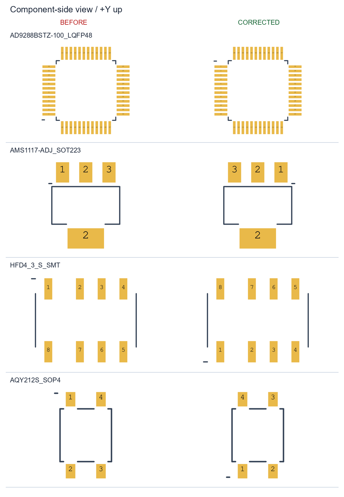

# Проверка посадочных мест, 24.10.2026

Проверены три `Lib/*.PcbLib` и все 277 компонентов
`AnalExtend/AnalExtend.PcbDoc` (26 типов footprint). Библиотечный вид —
со стороны компонента, +X вправо, +Y вверх. При размещении на Bottom Layer
Altium отражает footprint один раз.

## Исправления в Oscill.PcbLib, генераторе и размещённых компонентах

| Footprint | Было | Стало / основание |
| --- | --- | --- |
| `AD9288BSTZ-100_LQFP48` | Зеркальный обход площадок, pin 1 снизу слева | По ADI, рис. 5/34: pin 1 сверху слева, обход против часовой стрелки. Отражены Y площадок и метки; шаг 0,5 мм, медь 1,5×0,3 мм и маска сохранены |
| `AMS1117-ADJ_SOT223` | При язычке снизу pin 1 слева, 3 справа | По AMS Top View при таком повороте pin 1 справа, 3 слева. Исправлены площадки 1/3 и метка; обе площадки VOUT имеют номер 2 |
| `HFD4_3_S_SMT` | Hongfa Wiring Diagram перенесён как вид сверху, хотя подписан Bottom view | Отражены Y: 1–4 снизу, 8–5 сверху. Сохранены неравномерные шаги и стандартное исполнение S |
| `AQY212S_SOP4`, `AQY214S_SOP4` | 1/2 на противоположных сторонах корпуса | По Panasonic: 1/2 в одном ряду, 3/4 в другом; метка снизу слева. Размеры площадок и их центры сохранены |

Схемные символы и их нумерация не изменены. Остальные 14 footprint
основной библиотеки сохранены без изменения бинарных потоков примитивов.
На плате исправлены два AD9288, два AMS1117 и шесть HFD4. AQY на плате
не установлены. Изменены координаты площадок и метки первых выводов,
назначенные выводам сети сохранены.

## Проверка остальных footprint

| Footprint / группа | Результат и границы |
| --- | --- |
| `OPA356_SOIC8`, `AD8138ARZ_SOIC8`, `ADA4817-1ARDZ_SOIC8_EP` | Корректный обход 1–8, pin 1 сверху слева, шаг 1,27 мм. Медь EP 2,30×2,30 мм для номинального EPAD 2,29×2,29 мм; контакт 9 сохранён |
| `BAV99_SOT23` | 1/2 снизу, 3 сверху; 1=A1, 2=K2, 3=K1/A2 соответствует Nexperia |
| `ESD_LOW_CAP_SOD323` | 1=K, 2=A соответствует PESD5V0L1UA; совместимость с произвольным диодом SOD323 не следует из имени корпуса |
| `A0503S-2WR3_SIP5` | По YLPTEC A_S-2WR3: 1/2/4/5/6, вывода 3 нет; сетка 2,54 мм. Корпус 19,5×7 мм смещён относительно ряда на 1/6 мм. Отверстие 0,9 мм сохранено; чертёж рекомендует 1,0 мм при выводе 0,5×0,3 мм. Требуется сверить изготовителя закупаемого модуля |
| `ACH3218_3TERM_FILTER` | 2=GND, 1/3 — симметричная линия. Медь 1,4/0,6/1,4×1,94 мм соответствует TDK |
| `EC11E_ENCODER_SW` | A/C/B: шаг 2,5 мм, Y=−7,5 мм; D/E: шаг 5 мм, Y=7 мм; крепёж по Alps Drawing No. 2/3. Монтажный вид Alps не отражается повторно |
| `R_1206` | Медь 1,05×1,8 мм, зазор 1,5 мм по Vishay D/CRCW1206-P |
| `PBD_2X20_2P54_THT` | Сетка 2,54×2,54 мм и отверстия 1,02 мм по Connfly DS1023. Нумерация — соглашение проекта, требует согласованной ответной платы |
| `STM32F103RCT6_MODULE_PBD_2X14` | Сетка и нумерация согласованы с существующей картой модуля; внутренние ряды 20,32 мм, внешние 25,4 мм. Назначение контактов взято с фотографии, формального чертежа конкретного модуля нет |
| `TACT_SMD_ON_DIP8_RAISED` | DIP-8: шаг 2,54 мм, ряды 7,62 мм, группы 1–4/5–8. Пользовательская сборка, механика и высота требуют измерения |
| `BNC_VERTICAL_THT_5PIN` | Центральный сигнал и четыре вывода экрана согласованы со схемой. Артикул не задан; расположение лапок и отверстия нельзя подтвердить для произвольного BNC |
| `MINGWU_29P3X18P9_MECH` | Три NPTH без сетей, координаты согласованы с моделью. Крепления оценены по фотографии, не подтверждены чертежом или измерением |
| `MSK12C02`, `P_HEADER_1x5_2.54_ANGLE` | Размещённые площадки совпадают с отдельными библиотеками. MSK: общий 2, лапки корпуса 4, два NPTH. Гребёнка: шаг 2,54 мм; точные высота и длина выводов без артикула не подтверждены |
| `SOT23-3N` | Корректный SOT23, повёрнутый на 90°: 1/2 слева, 3 справа, шаг 1,9 мм. PJA3433 — G/S/D, BC848 — B/E/C |
| `SOD323` (BAT54J) | 1=K, 2=A; центры ±1,25 мм. BAT54J выпускается в SOD323F. Унаследованные параметры DO-35 в символе не описывают закупаемый корпус; параметры схемы не редактировались |
| `RESC2012(0805)N`, `CAPC2012(0805)N`, `CAP_CER_1206`, `INDC1608(0603)N` | Двухвыводные неполярные корпуса; геометрия всех экземпляров согласована с типоразмером. Конкретные артикулы для всех номиналов не заданы |
| `CAPMP3528X210N`, `CAPMP7343X310N` | Корпуса B/D, электрические площадки 1/2 по сторонам корпуса. Площадки 0 — на Mechanical 15, не в меди. Для C62 указан TAJB105K035SNJ; у остальных общий `CapTantD`, точный артикул не подтверждён |
| `LED_3MM_GREEN` | Два отверстия с шагом 2,54 мм. Корпус и полярность купленного LED требуют артикула |

## Фактические проверки и состояние платы

`py -3.12 Lib/_check_footprints.py` проверяет 19 сохранённых footprint
по контрольным координатам и направлению обхода. Требуется
`altium-monkey==2026.9.22`. Отрицательный прогон на исходной библиотеке
обнаружил все пять исправленных моделей.

На плате проверены 60 размещённых компонентов из трёх библиотек
и 217 компонентов остальных девяти типов. Они согласованы с исходной
геометрией соответствующих корпусов с учётом перечисленных исправлений.
Это проверка файлов, не аппаратное измерение.

Пробное обновление размещённых компонентов сохранило номера выводов,
сети, всю медную трассировку, полигоны и модели. Оно показало **88 контактов
площадок с дорожками других сетей**: по 24 у DA1/DA2, по 2 у двух AMS,
по 6 у шести HFD4. В исходном варианте для этих площадок было 0 таких
контактов. Проверка ограничена площадками и прямыми медными дорожками,
не заменяет полный DRC Altium.

При записи исправлений PcbDoc изменены только потоки `Pads6/Data` и
`Tracks6/Data` (метки первых выводов); остальные потоки сохранены побайтно.
Затем плата была открыта и сохранена в Altium параллельно проверке:
число дорожек изменилось с 6265 до 6264, обновились также полигоны и
служебные потоки. Эта последующая работа сохранена, автоматический
возврат исходного файла не выполнялся. Все 942 площадки актуального
файла совпадают с исправленным вариантом, назначение сетей сохранено.

**Исправленная плата требует переразводки, пересчёта полигонов и полного
DRC перед производством.** Число 88 относится к проверенному пробному
состоянию сразу после переноса исправлений, не к окончательной проверке
параллельно редактируемой платы. Схемы и `Manufacture/` не менялись;
существующие Gerber не содержат исправлений.

### Работа установленного AMS

Владелец подтвердил работу AMS на изготовленной основной плате. Это
наблюдение сохранено и не объявляется ошибочным. Текущий PcbDoc и версии
`aca7b1c`/`085b858` имеют одинаковую геометрию AMS, pin 3 подключён к 5 В,
pin 1 — к делителю ADJ. Несоответствие библиотечного вида сверху чертежу
AMS воспроизводится; **причина работы реального экземпляра не установлена**.
Для её установления нужны маркировка, ориентация установленного компонента
и проверка физических соединений. Замена номера площадки не является
проверкой работы регулятора.

## Источники

- [ADI AD9288, рис. 5/34](https://www.analog.com/media/en/technical-documentation/data-sheets/ad9288.pdf)
- [AMS AMS1117, стр. 1/7, SOT-223 Top View](https://files.waveshare.com/upload/b/b8/AMS1117-datasheet.pdf)
- [Hongfa HFD4, стр. 63/64, Bottom view](https://source.hongfa.com/Uploads/Product/PDF/HFD4_en.pdf)
- [Panasonic GU SOP, Dimensions](https://api.pim.na.industrial.panasonic.com/file_stream/main/fileversion/521)
- [ADI AD8138](https://www.analog.com/media/en/technical-documentation/data-sheets/ad8138.pdf), [ADA4817](https://www.analog.com/media/en/technical-documentation/data-sheets/ADA4817-1_4817-2.pdf), [TI OPA356](https://www.ti.com/lit/ds/symlink/opa356.pdf)
- [YLPTEC A_S-2WR3, стр. 5](https://datasheet.lcsc.com/datasheet/pdf/18536564cbf571f5a5e7111d1f49b2d7.pdf?productCode=C5369432)
- [TDK ACH3218](https://product.tdk.com/system/files/dam/doc/product/emc/emc/3tf/catalog/3tf_automotive_power_ach3218_en.pdf), [Alps EC11E](https://tech.alpsalpine.com/cms.media/product_catalog_ec_01_ec11e_en_611f078659.pdf)
- [Nexperia BAV99](https://assets.nexperia.com/documents/data-sheet/BAV99_SER.pdf), [PESD5V0L1UA](https://assets.nexperia.com/documents/data-sheet/PESD5V0L1UA.pdf), [BAT54J](https://assets.nexperia.com/documents/data-sheet/BAT54J.pdf), [BC848](https://assets.nexperia.com/documents/data-sheet/BC848_SER.pdf)
- [Panjit PJA3433](https://www.panjit.com.cn/upload/datasheet/PJA3433.pdf)

Прочие исходные чертежи и механические допущения —
[Lib/DEVELOPMENT.md](../Lib/DEVELOPMENT.md).
